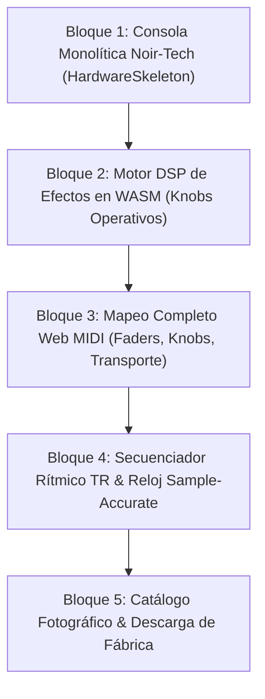

# ImpactSampler Studio - Web Edition (Fase 14)

> **Documento de Contexto y Especificación de Ingeniería**  
> **Estado:** Prototipo Base Operativo (WASM + Web MIDI + Drag & Drop SF2 Funcional)  
> **Ubicación:** `web-app/` (Desacoplado y excluido en `.gitignore` de la raíz)

---

## 1. Visión y Propósito

**ImpactSampler Studio Web Edition** es la adaptación para navegador de ImpactSampler Studio, diseñada para ofrecer una experiencia de estación de trabajo musical (DAW / Sampler) interactiva, con latencia ultra-baja y cero fricción:

- **Sin Instaladores ni Descargas Pesadas:** Cualquier usuario puede abrir un enlace web y comenzar a tocar de inmediato, eliminando las barreras de Windows Defender y Apple Gatekeeper.
- **Ejecución 100% en Cliente (Edge Computing):** La síntesis de audio ocurre íntegramente en la CPU del usuario mediante **WebAssembly (Rust)**. Cero streaming de audio y cero costos de servidor.
- **Control de Hardware Plug-and-Play con Web MIDI API:** Conexión nativa por USB con controladores físicos como el **Nektar Impact LX49+**, Akai MPK Mini, Arturia KeyLab, Novation Launchkey o teclados digitales estándar sin requerir drivers de terceros.
- **Aislamiento Arquitectónico:** La carpeta `web-app/` está totalmente desacoplada del repositorio de escritorio (`main`), asegurando que las compilaciones de Windows (`.exe` NSIS) y macOS (`.dmg` Universal) permanezcan intactas y libres de contaminación.

---

## 2. Stack Tecnológico

| Capa | Tecnologías | Propósito |
| :--- | :--- | :--- |
| **Frontend UI** | React 18, TypeScript, Tailwind CSS, Lucide Icons | Interfaz de consola monolítica Noir-Tech de alto rendimiento visual. |
| **Tipografía** | `@fontsource/geist-sans`, `@fontsource/geist-mono` | Tipografía tabular sin jitter para displays métricos y números. |
| **Bundler & Dev** | Vite 5, `vite-plugin-wasm`, `vite-plugin-top-level-await` | Servidor de desarrollo instantáneo (HMR) y empaquetado optimizado. |
| **Motor DSP (WASM)** | Rust 2024, `wasm-bindgen`, `rustysynth` | Síntesis SoundFont 2 y procesamiento digital de señales en tiempo real (**~119 KB** binario). |
| **Toolchain WASM** | `wasm-pack`, target `wasm32-unknown-unknown` | Compilación cruzada de Rust a WebAssembly nativo. |
| **Sub-sistema Audio** | Web Audio API (`AudioContext`, `AudioWorklet` / `ScriptProcessor`) | Salida de audio estéreo en tiempo real con latencia de ~10 ms. |
| **Sub-sistema MIDI** | Web MIDI API (`navigator.requestMIDIAccess`) | Captura de eventos MIDI de bajo nivel (`NoteOn`, `NoteOff`, `CC`) desde hardware USB. |

---

## 3. Estado Actual del Desarrollo (Avance 1 Completado ✅)

1. **Aislamiento en Git:** Directorio `/web-app/` añadido al `.gitignore` principal y sincronizado con `origin main`.
2. **Crate Rust WASM (`wasm-engine`):**
   - Compilación exitosa de `rustysynth` para el target `wasm32-unknown-unknown`.
   - Generación de los paquetes TypeScript y JavaScript en `src/wasm/` con un peso ultra-liviano de **119 KB**.
3. **Puente de Audio (`src/audio/WebAudioBridge.ts`):**
   - Inicialización atómica de `AudioContext` tras interacción del usuario.
   - Enlace directo con los métodos `note_on`, `note_off` y `render(left, right)` del motor WASM.
4. **Manejador Web MIDI (`src/midi/WebMidiManager.ts`):**
   - Detección reactiva de puertos y dispositivos MIDI conectados por USB.
   - Escucha de mensajes `NoteOn` y `NoteOff` con reenvío en tiempo real al motor de síntesis.
5. **Carga Local de SoundFonts:**
   - Soporte de Drag & Drop para arrastrar cualquier archivo `.sf2` a la ventana y cargarlo inmediatamente en la memoria RAM de WebAssembly sin usar internet.
6. **Validación de Compilación:**
   - `npm run build` verificado en **16.98 segundos** sin errores de tipos.
   - Servidor local verificado y probado con teclado físico.

---

## 4. Hoja de Ruta de Desarrollo (Equiparación con App Desktop)

Para que la Web App replique con exactitud la estética, profundidad y operatividad de la aplicación de escritorio, el desarrollo se organiza en los siguientes 5 bloques:



### Bloque 1: Consola Monolítica Noir-Tech (`HardwareSkeleton.tsx`) ✅ [COMPLETADO]
- [x] **Fondo de Estudio:** Atmósfera Noir-Tech con micro-malla acústica (`dot-matrix`), spotlight cenital y aura dinámica según el instrumento activo.
- [x] **Chasis Analógico:** Carcasa gris/negro con textura de aluminio cepillado y marco perimetral biselado.
- [x] **Display OLED Dual:** Pantalla con marco metálico oscuro mostrando `INST: [INSTRUMENTO]` (LED esmeralda) y `PATCH: 001 - ...` (LED ámbar).
- [x] **Consola de Faders:** 8 Faders analógicos con medidores de nivel (peak meters) + Master Fader 9 en cian con dB markings.
- [x] **Bahía de Knobs:** 8 perillas circulares con anillo SVG Arc de 270° e indicadores angulares.
- [x] **Performance Bay:** Cápsula de Arpegiador `[ ARP | HOLD | ⚙ ]` con motor melódico sample-accurate en Rust (modos Up/Down/UpDown, subdivisiones 1/4 a 1/32, 1-3 octavas, modo HOLD y control de BPM). Conmutadores de ruteo `[ FX KEYS | FX PADS ]`.
- [x] **Pads de Silicona:** 8 pads biselados con underglow cromático por rol tímbrico.
- [x] **Teclado de 49 Teclas:** 4 octavas completas (C2 a C6) con acabado realista y respuesta luminosa interactiva.
- [x] **Teclado QWERTY de PC:** Mapeo de dos octavas cromáticas (`A` a `;`), disparo de 8 pads (`1` a `8`), cambio de octava (`Z` / `X`) y serigrafía de letras dinámica en las teclas virtuales.

### Bloque 2: Motor DSP de Efectos en WebAssembly (`wasm-engine`) ✅ [COMPLETADO]
- [x] **Filtro Cytomic SVF Bipolar (Knobs 1 & 2):** LPF subacuático a la izquierda, Flat al centro y HPF aéreo a la derecha, con perilla de resonancia Q y suavizado exponencial anti-zipper.
- [x] **Warm Tube Overdrive con Auto-Gain Matching (Knob 3):** Saturación no-lineal asimétrica valvular (`tanh`) con pre-ganancia de hasta +21.6 dB y compensación adaptativa de nivel de salida.
- [x] **Delay Estéreo con Soft-Clipping Feedback & Reverb Schroeder (Knobs 4, 5, 6, 7):** Buffer circular estéreo de 2s con interpolación de retardo (40ms-1000ms), 8 peines + 4 allpasses estéreo y control Chorus.
- [x] **Panorámica Estéreo, Master Fader & Soft Limiter Analógico (Knob 8 / Fader 9):** Paneo por ley de potencia constante y saturador analógico no-lineal para evitar recortes digitales duros a 0 dBFS.

### Bloque 3: Mapeo Completo de Hardware Web MIDI ✅ [COMPLETADO]
- [x] **Faders Analógicos:** CC 71 a 78 (o CC 38 a 45) controlando los faders en pantalla; CC 79 / 46 controlando el Master Fader 9.
- [x] **Knobs de Efectos:** CC 21 a 28 (o CC 56 a 63) moviendo las perillas en pantalla en tiempo real con suavizado DSP.
- [x] **Pitch Bend & Mod Wheel:** Rueda de pitch bend con retorno por resorte y rueda de modulación CC 1 sincronizadas bidireccionalmente.
- [x] **Transporte Físico & DAW:** CC 106 (Play/Pause), CC 105 (Stop con corte inmediato de notas y reseteo de compás), CC 107 (Record overdub toggle), CC 103 (Rewind / -1 BPM), CC 104 (Forward / +1 BPM), CC 47 (Click / Metrónomo toggle).
- [x] **Cápsula de Transporte Noir-Tech:** Módulo de hardware unificado en Header `[ ■ STOP | ▶ PLAY | ● REC | ♫ CLICK | Medidor de 4 Beats ]` con LEDs reactivas (acento ámbar en beat 1, esmeralda en beats 2-4).
- [x] **Sintetizador Piezoeléctrico de Metrónomo:** Generador Web Audio de clic acústico ultra-rápido (1600 Hz acento / 1000 Hz beat normal con decaimiento analógico de 35ms a nivel de muestra).
- [x] **Atajos de Transporte QWERTY:** `[Barra Espaciadora]` para Play/Pause y `[Escape]` para Stop inmediato.


### Bloque 4: Secuenciador Rítmico de 16 Pasos (`StepSequencer.tsx`) ✅ [COMPLETADO]
- [x] **Modo Workstation:** Conmutador serigrafiado de hardware `[ KEYS ]` y `[ SEQ ]` para alternar entre el teclado analógico de 49 teclas y la matriz rítmica TR.
- [x] **Grilla Rítmica TR:** 8 pistas de instrumentos de percusión con 16 botones mecánicos biselados estilo Roland TR (acabado titanio/grafito, división visual por compases y micro-lentes ópticos LED internos).
- [x] **Cinta Superior de Herramientas:** Bancos independientes A/B con hot-swapping, resolución de grid conmutable (1/8, 1/16, 1/32 con paginación de 32 pasos) y cápsula de control `[ UNDO | CLR TRK | CLR ALL ]`.
- [x] **Transporte Rápido y Tap Tempo:** Sincronización bidireccional de Play/Stop/Rec/Metrónomo y botón TAP para calcular el tempo con latencia cero.
- [x] **Reloj Sample-Accurate en Rust:** Motor de ticks (384 ticks/compás, 96 ticks/negra) embebido en WebAssembly `WasmEngine::render()` que dispara los pads en el sub-frame exacto sin jitter en el hilo de audio.
- [x] **Cabeza Lectora a 60 FPS:** Animación fluida de barrido con barrido LED que ilumina el paso activo en tiempo real.

### Bloque 5: Catálogo Fotográfico y Carga de Fábrica
- [x] **Modal de Instrumentos (`InstrumentSelectModal.tsx`):** Catálogo interactivo con renders fotográficos PNG (Grand Piano, Rhodes Mark I, Mellotron Tape, Yamaha RX7).
- [x] **Descarga Automatizada desde GitHub Releases:** Botón con barra de progreso en tiempo real (`ReadableStream`) para descargar directamente el kit ligero de fábrica Yamaha RX7 (~19 MB) o pianos desde `soundfonts-v1.0.0`.
- [x] **Persistencia Local (`IndexedDB`):** Almacenamiento local del SoundFont en el navegador del usuario para carga offline instantánea en visitas futuras.

---

## 5. Guía de Comandos para Desarrollo

Todos los comandos deben ejecutarse dentro del subdirectorio `web-app/`:

```bash
# 1. Iniciar servidor local de desarrollo
cd web-app
npm run dev

# 2. Recompilar el módulo Rust a WebAssembly tras cambios en wasm-engine/
npm run wasm:build

# 3. Compilar el bundle de producción para despliegue web (Vercel, GitHub Pages, etc.)
npm run build

# 4. Previsualizar el build de producción localmente
npm run preview
```

---

## 6. Principio de No Regresión
Cualquier avance, archivo o dependencia introducida dentro de `web-app/` debe respetar estrictamente:
- **Cero cambios en la raíz:** No modificar `package.json` ni `src-tauri/Cargo.toml` de la aplicación de escritorio.
- **Independencia Total:** La Web App debe poder ejecutarse y compilarse de manera autónoma, sirviendo como demostración comercial o producto web independiente.
