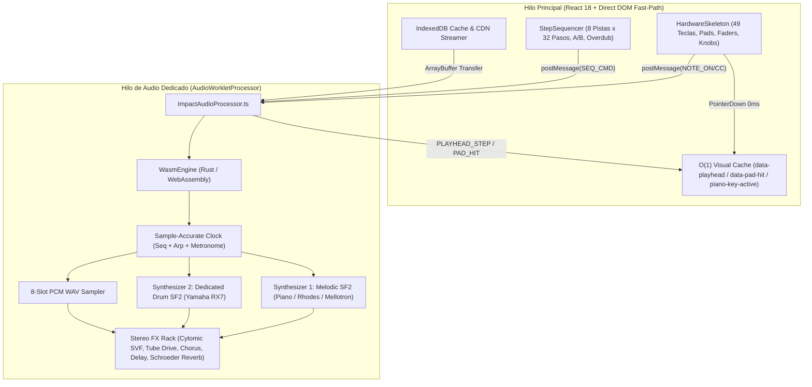

# ImpactSampler Studio - Web & Mobile Edition (Fase 14)

> **Documento de Contexto y Especificación de Ingeniería**  
> **Estado:** Producción Operativa (WASM Dual-Synth + AudioWorklet + Web MIDI + Vista Mobile Landscape Zero-Latency)  
> **Ubicación:** `web-app/` (Repositorio independiente desplegado en Vercel y aislado en `.gitignore` de la raíz Desktop)

---

## 1. Visión y Propósito

**ImpactSampler Studio Web & Mobile Edition** es la adaptación multiplataforma para navegadores de escritorio y dispositivos móviles de ImpactSampler Studio, diseñada para ofrecer una estación de trabajo musical (DAW / Sampler / Secuenciador TR) interactiva, con latencia ultra-baja y cero fricción:

- **Sin Instaladores ni Barreras de Entrada:** Cualquier usuario en PC, Mac, tablet o smartphone puede abrir el enlace web y tocar de inmediato con instrumentos reales precargados, eliminando las advertencias de Windows Defender y Apple Gatekeeper.
- **Ejecución 100% en Cliente (Edge Computing en Hilo Dedicado):** La síntesis polifónica dual, el sampler PCM, el rack de efectos DSP y el reloj del secuenciador corren íntegramente en un **`AudioWorkletProcessor` dedicado** impulsado por **WebAssembly (Rust)**. Cero streaming de audio, cero bloqueos por la UI y cero costos de servidor.
- **Control de Hardware Plug-and-Play con Web MIDI API:** Conexión nativa por USB/OTG con controladores físicos como el **Nektar Impact LX49+**, Akai MPK Mini, Arturia KeyLab, Novation Launchkey o teclados digitales estándar sin requerir drivers adicionales, además de **MIDI Learn** y asistente de calibración.
- **Experiencia Mobile Landscape Touch-First:** Diseño adaptativo en orientación horizontal con selector de bancos del panel superior (`FADERS`, `FX RACK`, `PADS`), auto-colapso inteligente en modo secuenciador (`SEQ`) y motor gráfico DOM `O(1)` de respuesta táctil en `0 ms`.
- **Aislamiento Arquitectónico:** La carpeta `web-app/` está completamente desacoplada del repositorio de escritorio (`main`), garantizando que las compilaciones nativas de Windows (`.exe` NSIS) y macOS (`.dmg` Universal) permanezcan intactas.

---

## 2. Stack Tecnológico

| Capa | Tecnologías | Propósito |
| :--- | :--- | :--- |
| **Frontend UI** | React 18, TypeScript, Tailwind CSS, Lucide Icons | Interfaz de consola monolítica Noir-Tech adaptable a Desktop y Mobile Landscape. |
| **Tipografía** | `@fontsource/geist-sans`, `@fontsource/geist-mono` | Tipografía técnica tabular sin jitter para displays OLED y telemetría. |
| **Bundler & Dev** | Vite 5, `vite-plugin-wasm`, `vite-plugin-top-level-await` | Empaquetado optimizado con soporte para `AudioWorklet` y módulos WASM. |
| **Motor DSP (WASM)** | Rust 2024, `wasm-bindgen`, `rustysynth` | Motor híbrido Dual-Synth (Melódico + Drum SF2), Sampler WAV de 8 pistas, Arpegiador, Secuenciador y Rack FX (**~171 KB** binario). |
| **Sub-sistema Audio** | Web Audio API (`AudioWorkletNode` + `ImpactAudioProcessor.ts`) | Renderizado lock-free en hilo de audio dedicado a bloques de 128 muestras (~2.6 ms a 48 kHz). |
| **Sub-sistema MIDI** | Web MIDI API (`navigator.requestMIDIAccess`) | Captura de eventos MIDI (`NoteOn`, `NoteOff`, `CC`, `PitchBend`) con MIDI Learn y perfiles persistentes. |
| **Almacenamiento Local** | `IndexedDB` (`soundfontCache.ts`) + `localStorage` | Caché persistente de bancos SoundFont (`.sf2`) y preferencias/calibración del usuario. |
| **Infraestructura CDN** | GitHub Releases + Proxy `/sf2-cdn/` (Vite / Vercel Rewrites) | Descarga transparente de SoundFonts de fábrica evitando bloqueos CORS. |

---

## 3. Arquitectura del Sistema y Logros Técnicos Consolidados



---

## 4. Bloques de Ingeniería Completados ✅

### Bloque 1: Consola Monolítica Noir-Tech (`HardwareSkeleton.tsx`) ✅ [COMPLETADO]
- [x] **Chasis Analógico y Display OLED Dual:** Pantalla metálica mostrando instrumento activo (`INST:`), preset (`PATCH:`), octava y telemetría de audio/MIDI en tiempo real.
- [x] **Consola de 9 Faders:** 8 faders individuales para ganancia de los 8 buses de percusión (`0.0` a `1.5x`) con medidores de nivel (peak meters) + Master Fader 9 en cian con escala en dB y doble clic para reset.
- [x] **Bahía de 8 Knobs Reasignables:** Perillas circulares con anillo SVG de 270°, menú contextual con clic derecho para reasignar cualquiera de los 9 parámetros DSP en caliente y doble clic para valor nominal.
- [x] **Performance Bay & Arpegiador:** Cápsula `[ ARP | HOLD | ⚙ ]` con motor sample-accurate en Rust (modos *Up*, *Down*, *Up-Down*, *Random*, subdivisiones `1/4` a `1/32`, `1` a `3` octavas y modo `HOLD`). Conmutador de ruteo selectivo de efectos (`KEYS | BOTH | PADS`).
- [x] **8 Pads de Silicona Multimodo:** Tres modos de operación en tiempo real:
  1. `WAV SAMPLER`: Muestras `.wav` independientes por pad (con kit electrónico sintetizado de fábrica en el arranque, soporte Drag & Drop de archivos `.wav` propios y conmutación *One-Shot* / *Gate*).
  2. `DRUM SF2`: Batería dedicada **Yamaha RX7** corriendo en un segundo sintetizador SoundFont paralelo.
  3. `MIRROR`: Espejo cromático del instrumento melódico principal.
- [x] **Teclado de 49 Teclas (C2 a C6) + Rango Auténtico Mellotron:** Glissando táctil y de puntero, ruedas de *Pitch Bend* (con retorno por resorte) y *Modulation* (`CC 1`), y atenuación visual/mecánica fuera del rango de 35 cintas (`G2` a `F5`) cuando se selecciona el Mellotron.
- [x] **Modo Teclado QWERTY (Exclusivo Desktop):** Mapeo de dos octavas cromáticas (`A` a `;`), disparo de pads (`1` a `8`), cambio de octava (`Z` / `X`), serigrafía dinámica sobre las teclas y desactivación automática en dispositivos móviles/táctiles.

---

### Bloque 2: Motor Dual-Synth y Efectos DSP en WebAssembly (`wasm-engine` + `AudioWorklet`) ✅ [COMPLETADO]
- [x] **Migración a `AudioWorkletNode` (`ImpactAudioProcessor.ts`):** El motor WASM se ejecuta íntegramente en el hilo de audio de alta prioridad del navegador, aislando el sonido de cualquier carga gráfica o evento del DOM.
- [x] **Arquitectura Dual-Synth en Rust (`lib.rs`):**
  - **Sintetizador Melódico Principal (`synth`):** Dedicado a las 49 teclas y al arpegiador (Grand Piano, Rhodes Mark I, Mellotron Tape o `.sf2` de usuario).
  - **Sintetizador Rítmico Independiente (`drum_synth`):** Dedicado a los 8 pads y al secuenciador en modo `DRUM SF2` (`Yamaha_RX7_Drums.sf2`), permitiendo tocar el piano con las teclas mientras el secuenciador dispara la batería RX7 simultáneamente sin conflictos de presets.
- [x] **Rack de Efectos Estéreo en Rust:**
  - **Filtro Cytomic SVF Bipolar (Knobs 1 & 2):** Filtro DJ continuo (*Low-Pass* a la izquierda, neutro al centro, *High-Pass* a la derecha) con control de resonancia `Q` y suavizado exponencial libre de *zipper noise*.
  - **Warm Tube Overdrive con Auto-Gain (Knob 3):** Saturación asimétrica valvular (`tanh`) con compensación automática de ganancia.
  - **Reverb Estéreo Schroeder-Moorer & Chorus (Knobs 4 & 8):** Red de 8 filtros peine + 4 filtros *all-pass* estéreo y modulación espacial.
  - **Delay Estéreo con Soft-Clipping Feedback (Knobs 5, 6, 7):** Línea de retardo circular de 2 segundos (`40 ms` a `1000 ms`) con filtrado en el lazo de realimentación.
  - **Panorámica de Potencia Constante & Soft Limiter Master:** Protección analógica en el bus maestro a `0 dBFS`.

---

### Bloque 3: Mapeo Web MIDI, Calibración y Asistente Interactivo Vostok ✅ [COMPLETADO]
- [x] **Detección Reactiva Web MIDI (`WebMidiManager.ts`):** Reconocimiento plug-and-play de controladores USB/MIDI, mapeo nativo del **Nektar Impact LX49+** (Faders, Knobs, Pads, Transporte `CC 103–107` y Metrónomo `CC 47`).
- [x] **Asistente de Calibración y MIDI Learn (`CalibrationWizardModal.tsx`):**
  - **Calibración de Latencia de 8 Golpes:** Medición estadística de desviación en milisegundos siguiendo el metrónomo para compensar la latencia física del usuario/sistema.
  - **MIDI Learn Universal:** Asignación interactiva paso a paso para mapear los 8 pads, 9 faders y 8 knobs de cualquier controlador MIDI del mercado, persistiendo el perfil en `localStorage`.
- [x] **Asistente Virtual "Vostok" (`StudioAssistantAvatar.tsx` & `OnboardingTour.tsx`):**
  - Avatar robótico Noir-Tech con animaciones expresivas de ojos LED y burbujas contextuales que reaccionan a cambios de instrumento, activación de efectos, grabación rítmica y conexión MIDI.
  - **Tour Guiado Interactivo de 8 Pasos:** Recorrido con *spotlight* dinámico que explica cada módulo del estudio a nuevos usuarios.

---

### Bloque 4: Secuenciador Rítmico TR de 32 Pasos y Grabación Cuantizada (`StepSequencer.tsx`) ✅ [COMPLETADO]
- [x] **Reloj Sample-Accurate en Rust:** Generador de pulso interno a nivel de muestra dentro de `WasmEngine::render()`, garantizando disparo en el sub-frame cero al pulsar `PLAY` y sincronía perfecta con el sintetizador piezoeléctrico del metrónomo.
- [x] **Matriz TR de 8 Pistas × 32 Pasos:** Bancos independientes `A` y `B` con *hot-swap*, resoluciones de rejilla `1/8`, `1/16` y `1/32` con paginación automática (`PÁG 1: 1-16` / `PÁG 2: 17-32`) y herramientas `[ UNDO | CLR TRK | CLR ALL ]`.
- [x] **Grabación Overdub Cuantizada en Tiempo Real:** Al activar `REC` durante la reproducción, los golpes ejecutados en los pads (táctiles, mouse, QWERTY o MIDI) se cuantizan automáticamente al paso más cercano (compensando la latencia calibrada) y se registran en vivo en la matriz.

---

### Bloque 5: Catálogo de Fábrica, Arranque Dual y Caché Inteligente (`IndexedDB`) ✅ [COMPLETADO]
- [x] **Arranque Instantáneo de Fábrica (Grand Piano + Yamaha RX7):**
  - Al abrir la Web App por primera vez, el sistema descarga y almacena automáticamente en `IndexedDB` tanto el **Grand Piano (`Piano - Realtime.sf2`)** para el teclado como el **Yamaha RX7 Drum Kit (`Yamaha_RX7_Drums.sf2`)** para los pads y el secuenciador, dejando el modo `DRUM SF2` activo por defecto.
  - En visitas posteriores, ambos motores cargan instantáneamente desde `IndexedDB` sin consumir ancho de banda.
- [x] **Descarga en Segundo Plano (Solo Desktop):** En ordenadores de escritorio, una cola silenciosa en segundo plano pre-descarga `Mellotron.sf2` y `Rhodes.sf2` hacia `IndexedDB` para que el cambio de instrumento sea inmediato. En móviles se desactiva esta pre-descarga automática para preservar ancho de banda, memoria RAM y fluidez de CPU/I/O.

---

### Bloque 6: Vista Mobile Landscape y Optimización Gráfica Zero-Latency ✅ [COMPLETADO]
- [x] **Guardia de Orientación Horizontal (`PortraitOrientationOverlay`):** En pantallas móviles en vertical (*portrait*), muestra un aviso Noir-Tech solicitando girar el teléfono a horizontal (*landscape*) para aprovechar todo el ancho para las 49 teclas y los 16 pasos del secuenciador.
- [x] **Ergonomía Compacta Mobile (`< 1024px`):**
  - **Header Compacto (`h-9`):** Integra un selector por pestañas del panel superior (`FADERS`, `FX RACK`, `PADS`) para alternar limpiamente entre módulos sin saturar la pantalla, ocultando el botón `QWERTY` (`hidden lg:flex`).
  - **Auto-Colapso en Vista Secuenciador (`SEQ`):** Al cambiar a la vista `SEQ` en móvil, el panel superior (`Top Deck`) se oculta automáticamente (`hidden lg:flex`), cediendo el 100% de la altura útil a la cinta de control del secuenciador, las **8 pistas completas de batería** y la barra inferior de transporte (`KEYS | SEQ`, `STOP | PLAY | REC`).
  - **Avatar Vostok No-Intrusivo:** El asistente flotante se oculta en móvil (`hidden lg:block`) para no superponerse jamás sobre el botón `REC` ni los controles del secuenciador.
- [x] **Arquitectura Gráfica de Latencia Cero (`0 ms` Touch-to-Photon y `0` Re-renders por Pulso):**
  - **Playhead y Golpes de Pad vía DOM Directo (`O(1)`):** El avance del playhead a semicorcheas y la iluminación de teclas/pads actualizan atributos DOM (`data-playhead="true"`, `data-pad-hit="true"`, `.piano-key-active`) mediante diccionarios pre-indexados (`Map<number, HTMLElement>`), evitando re-renderizar el árbol de React en cada pulso.
  - **Iluminación Síncrona en `onPointerDown`:** Tanto las 49 teclas del piano como los 128 botones del secuenciador utilizan `onPointerDown` con `touch-none` y contenedores `overflow-hidden gpu-contain`, eliminando los ~120–150 ms de retraso del detector de scroll táctil de Android/iOS y eliminando las transiciones CSS (`transition: all 75ms`) que demoraban el encendido visual.
  - **Alivio de Fill-Rate en GPU Móvil:** Los desenfoques Gaussianos pesados (`backdrop-blur-md`, `filter: brightness()`, sombras `box-shadow` multicapa y capas decorativas `mask-image` de pantalla completa) se restringen exclusivamente a escritorio (`lg:`), logrando 60 FPS constantes en navegadores móviles.

---

## 5. Guía de Comandos para Desarrollo

Todos los comandos deben ejecutarse dentro del subdirectorio `web-app/`:

```bash
# 1. Iniciar servidor local de desarrollo
cd web-app
npm run dev

# 2. Recompilar el módulo Rust a WebAssembly tras cambios en wasm-engine/
npm run wasm:build

# 3. Compilar el bundle de producción para despliegue web (Vercel)
npm run build

# 4. Previsualizar el build de producción localmente
npm run preview
```

---

## 6. Principio de No Regresión
Cualquier avance, archivo o dependencia introducida dentro de `web-app/` respeta estrictamente:
- **Cero cambios en la raíz Desktop:** No modifica `package.json` ni `src-tauri/Cargo.toml` de la aplicación nativa de escritorio.
- **Independencia Total:** La Web App se compila y despliega de manera autónoma en su propio repositorio (`ImpactSamplerStudio-web`), funcionando en PC, Mac, Android e iOS desde el navegador.
